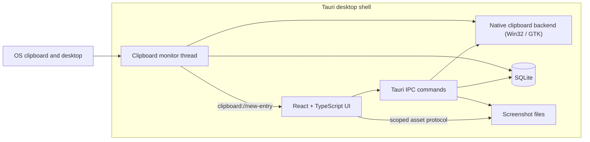

# LucidClip

**A privacy-first, local-only clipboard and screenshot history manager for Windows and Linux desktops.**

LucidClip keeps copied text, images, file references, and captured screenshots searchable on the local machine. It does not require an account, does not upload data, and does not include telemetry.

> **Project status:** Windows remains the primary release target. The clipboard pipeline also runs on Linux through GTK, with text/image/file capture, SQLite persistence, diagnostics, pause/resume, and manual capture. Screenshot capture, launch-at-login, and foreground-app exclusions remain Windows-only. OCR and global hotkeys remain planned and are not exposed as working controls.
>
> **Platforms:** Windows 10 / Windows 11 (64-bit target); Linux with GTK 3 and an X11 or Wayland session
>
> **Backend:** Rust, Tauri 2, SQLite
>
> **Frontend:** React 18, TypeScript, Vite, Tailwind CSS

---

## Implemented behavior

### Clipboard history

- Windows listens for native `WM_CLIPBOARDUPDATE` notifications; Linux listens for the GTK `owner-change` signal. Both use a debounce and a two-second safety pass, with a conservative polling fallback.
- Windows captures Unicode or legacy ANSI text, `CF_DIB`/`CF_DIBV5` images with a `CF_BITMAP` fallback, and Explorer `CF_HDROP` file lists.
- Linux captures CLIPBOARD-selection text, images, and `text/uri-list` file references through GTK without requiring `wl-clipboard`, `xclip`, or `xsel`.
- Classifies text as plain, multiline, URL, JSON, code, color, or file path; images and file lists use dedicated types.
- Normalizes text, deduplicates by domain-separated SHA-256 hashes, and refreshes the timestamp of repeated content.
- Stores clipboard images as PNG originals plus 320x180-bounded thumbnails under the screenshot directories.
- Stores history in SQLite with WAL mode and clipboard media metadata, ordered deterministically by timestamp and id.
- Supports pin, favorite, delete, manual snippets, clear-history, copy-back in the original format, and explicit "Capture now".
- Honors configurable maximum entry counts and cleanup age; pinned and favorite entries are preserved.
- Skips configured source applications on Windows and clipboard contents marked sensitive by Windows opt-out formats or the KDE password-manager hint on Linux.
- Emits a versioned event after persistence so the UI updates immediately; malformed or future-version payloads are ignored.
- Shows clipboard backend, session, capability, capture count, and last error in Settings, without logging clipboard contents.
- Removes orphaned clipboard media left by a crash on the next startup without touching screenshot files.

### Screenshots

- Captures the Windows virtual desktop through GDI (Windows only).
- Supports region capture by dragging a rectangle over a real desktop snapshot (Windows only).
- Writes PNG originals and aspect-preserving thumbnails to the app data directory.
- Persists dimensions, file size, capture type, and screen-relative region bounds.
- Supports pin, favorite, delete, copy-image-to-clipboard through `CF_DIB`, and PNG export to the Downloads folder.
- Removes image files only after the database row is deleted, avoiding gallery records that point at missing files.
- Clipboard images share the same scoped storage directories but never appear in the screenshot gallery.

### Settings and storage

- Persists settings as JSON in SQLite.
- Applies launch-at-login through the per-user Windows `Run` registry key (Windows only).
- Shows real SQLite and screenshot storage sizes plus entry counts.
- Reports backend failures instead of silently replacing data with empty results.

### Background operation

- A system tray icon exposes Show LucidClip and Quit LucidClip (where supported by the desktop environment).
- Closing the main window hides it instead of ending clipboard monitoring.
- Quit is the explicit way to stop the backend and monitor thread.

### Not implemented

- Screenshot text extraction (OCR).
- Global hotkeys outside the focused LucidClip window.
- Configurable screenshot save directory.
- Linux screenshot capture, launch-at-login, and foreground-app exclusion enforcement.
- Windows installer signing and release packaging.

These items are deliberately not presented as working controls.

---

## Quick start

Requires Node.js 20+, npm, and the Tauri 2 prerequisites for your platform.

```bash
npm install

# Launch the Vite frontend and Tauri desktop shell
npm run dev

# Frontend-only browser development
npm run dev:frontend

# Verification
npm test
npm run typecheck
npm run build
cd backend && cargo test
```

`npm run dev` resolves all paths from the repository root and starts Vite on port `1420`, matching the Tauri `devUrl`.

---

## Storage layout

On Windows, application data is stored under `%LOCALAPPDATA%\LucidClip\`. On Linux the XDG data directory resolved by the `directories` crate is used (typically `~/.local/share/lucidclip/`):

```text
LucidClip/
├── lucidclip.db            SQLite database (WAL mode)
├── screenshots/
│   ├── originals/          Screenshot and clipboard PNG files
│   └── thumbnails/         320x180-bounded PNG previews
└── logs/                   Reserved for diagnostics
```

Clipboard contents are never written to diagnostic logs. Screenshot files are exposed to the webview only through Tauri's scoped asset protocol.

---

## Architecture



- The clipboard monitor listens for native Windows or GTK change notifications, debounces bursts, and keeps a two-second safety pass plus a polling fallback; pause, exclusion, and retention settings apply before persistence.
- Closing the main window hides it to the tray; the monitor keeps running until Quit is selected.
- Capture and persistence run in the Rust backend; the frontend only requests operations and renders real stored data.
- The browser development build uses local adapters and refuses operations that require native capture.

---

## Repository layout

```text
LucidClip/
├── backend/                 Rust + Tauri 2 application
│   ├── src/clipboard/       Monitor, classification, hashing, service
│   ├── src/commands/        IPC command handlers
│   ├── src/database/        SQLite connection, migrations, repositories
│   ├── src/platform/        Windows/Linux clipboard, GDI/GTK, registry, diagnostics
│   ├── src/screenshots/     Capture, crop, thumbnail, export service
│   ├── src/storage/         Local data paths
│   └── tauri.conf.json      Window and build configuration
├── frontend/                React + TypeScript + Vite UI
│   └── src/services/        Typed Tauri and browser adapters
├── scripts/                 Launcher and integrity tests
└── docs/                    Architecture, backend, frontend, and design notes
```

---

## Privacy

- No account, cloud sync, analytics, or remote API calls.
- Clipboard text, clipboard media, and screenshot files stay on the local machine.
- Sensitive clipboard formats can be skipped where the OS exposes an opt-out marker.
- Source applications can be excluded on Windows.
- Monitoring can be paused at any time, and manual capture never runs in the background.
- Deleting history removes local rows and clipboard media files; screenshot deletion removes its image files.

## Limitations

- Windows screenshot, startup, and foreground-app behavior can only be fully verified on Windows.
- Linux clipboard support is implemented with GTK 3 and was verified on a GNOME Wayland host for native read/write round-trip and GTK `owner-change` notification delivery; other compositors, especially compositors that restrict background clipboard reads, still need testing.
- Linux does not expose foreground application identity to this backend, so per-app exclusions are stored but cannot be enforced. Sensitive detection on Linux is limited to the KDE password-manager hint target.
- On Windows, bitmap capture accepts uncompressed 16/24/32-bit `CF_DIB` data and file capture accepts wide-character `CF_HDROP` lists.
- Rich text and HTML clipboard formats are not preserved; their plain-text representation is captured when available.
- Cross-compiling the full backend on Linux is blocked by the bundled SQLite build needing a MinGW C compiler; Windows-only modules are checked separately with the GNU target.
- OCR and global shortcut behavior remain roadmap items rather than shipped features.
- The tray icon uses the bundled application icon; native tray behavior is verified on Windows during release testing.

## License

The project license has not been finalized. Do not assume permission to redistribute or modify the repository until a license is added.
