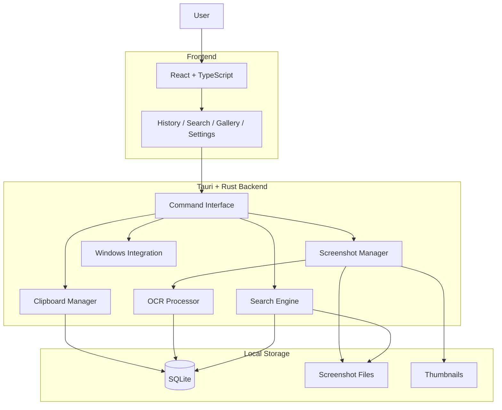
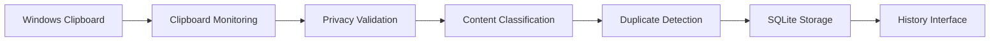
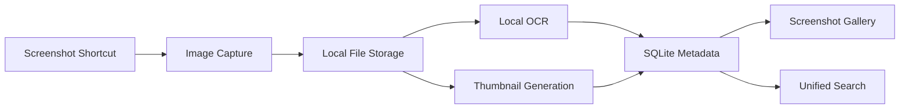
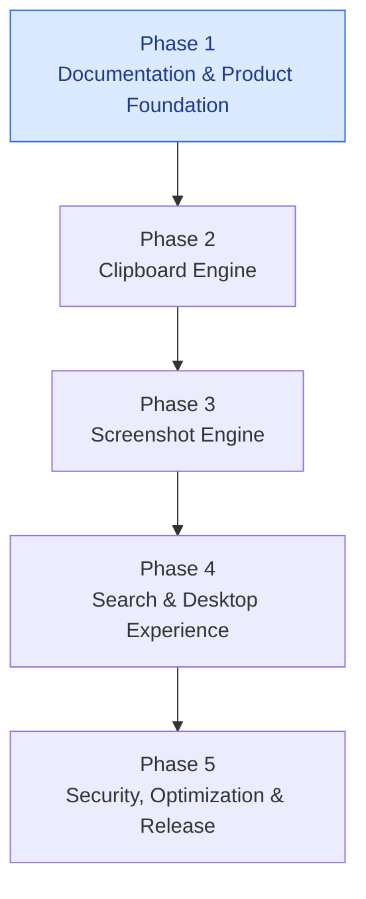

# LucidClip

### Everything you copy. Everything you capture. Always within reach.

**A privacy-first Windows clipboard and screenshot history manager.**

LucidClip aims to make previously copied text and captured screenshots instantly searchable and retrievable through one lightweight desktop application.

Instead of losing important information when copying something new, LucidClip is designed to preserve your clipboard history and screenshots locally, giving you a centralized place to find them whenever you need them.

> **Project Status:** Phase 1 — Documentation & Product Foundation  
> **Platform:** Windows 10 / Windows 11  
> **Development:** In Progress

---

## Overview

Have you ever copied something important, copied something else, and then realized the previous content was gone?

Or captured a screenshot and struggled to find it later?

Traditional clipboard functionality makes retrieving previously copied information unnecessarily difficult.

**LucidClip aims to solve this problem.**

It is being designed as a unified desktop utility that automatically remembers supported clipboard content and screenshots, allowing users to search, organize, preview, and retrieve their previous activity.

Whether you're a student collecting study material, a developer saving code snippets, a designer collecting visual references, or someone who regularly works on a computer, LucidClip aims to make information retrieval effortless.

---

## Why LucidClip?

| Problem | LucidClip's Approach |
|---|---|
| Previous copied text gets overwritten | Persistent clipboard history |
| Important URLs get lost | Searchable URL history |
| Code snippets disappear | Organized code history |
| Screenshots become difficult to find | Centralized screenshot library |
| Text inside screenshots is difficult to retrieve | Local OCR-based search |
| Frequently used content needs repeated copying | Pinned and favorite entries |
| Clipboard history may contain sensitive information | Local-first storage and privacy controls |

---

## Planned Features

The following features are part of the product roadmap and are not claims of currently implemented functionality.

### 1. Smart Clipboard History

Preserve previously copied content in a searchable history.

- Automatic clipboard monitoring.
- Text and multiline content support.
- URL and code snippet classification.
- Duplicate detection.
- Timestamp-based history.
- Pin and favorite entries.
- Copy previous content instantly.
- Configurable history retention.

### 2. Screenshot History

Keep previously captured screenshots organized in one location.

- Full-screen capture.
- Selected-region capture.
- Configurable screenshot shortcut.
- Screenshot previews.
- Thumbnail generation.
- Local image storage.
- Pin and delete screenshots.
- Export screenshots.

### 3. Local OCR Search

Make screenshot content searchable.

- Extract text from captured screenshots.
- Process images locally.
- Search screenshots using extracted text.
- Retrieve screenshots through keywords.
- Process OCR jobs asynchronously.

### 4. Unified Search

One search interface for previously copied and captured information.

- Search clipboard history.
- Search URLs and code snippets.
- Search screenshot OCR content.
- Filter by content type.
- Filter pinned and favorite items.
- Sort by capture time.

### 5. Quick Access

Access previous content without interrupting your workflow.

- Global keyboard shortcuts.
- Floating quick-access interface.
- Keyboard navigation.
- Instant clipboard retrieval.
- Configurable shortcuts.

### 6. Windows System Integration

Designed to work naturally with Windows.

- System tray integration.
- Background operation.
- Optional startup with Windows.
- Monitoring pause and resume.
- Native Windows installer.

---

## Product Design

LucidClip follows a minimalist desktop design philosophy.

**Visual direction:**
- Dark graphite interface.
- Neutral black and charcoal surfaces.
- Clean typography.
- Subtle borders.
- Restrained accent colors.
- Minimal animations.
- Keyboard-first interactions.

The goal is to create a professional desktop utility that feels comfortable to use every day.

---

## System Architecture

LucidClip is planned around a modular, local-first desktop architecture.

### Technology Stack

| Technology | Purpose |
|---|---|
| Tauri 2 | Desktop application framework |
| Rust | Native backend and system integration |
| React | User interface |
| TypeScript | Frontend type safety |
| Vite | Frontend build tooling |
| Tailwind CSS | Styling |
| SQLite | Local persistent storage |
| Local OCR Engine | Screenshot text extraction |
| Windows APIs | Clipboard and desktop integration |

### High-Level Architecture



### Data Flow

**Clipboard pipeline**



**Screenshot pipeline**



---

## Privacy First

Privacy is a fundamental design requirement.

LucidClip is intended to follow a local-first approach.

Our planned privacy principles:

- No mandatory account registration.
- No cloud uploads by default.
- No telemetry by default.
- Local screenshot storage.
- Local OCR processing.
- Clipboard monitoring controls.
- Configurable sensitive application exclusions.
- User-controlled data deletion.
- No external AI API dependency for core functionality.

Clipboard histories can contain sensitive information. LucidClip must provide clear controls over what gets monitored and stored.

---

## Development Roadmap

LucidClip is being developed in five phases.



### Phase 1 — Documentation & Product Foundation

- Product requirements.
- Design system.
- System architecture.
- Feature specifications.
- Database model.
- Security and privacy documentation.
- Development roadmap.
- Contribution guidelines.

### Phase 2 — Clipboard Engine

- Tauri and Rust foundation.
- SQLite integration.
- Native clipboard monitoring.
- Persistent clipboard history.
- Content classification.
- Duplicate detection.
- Search and history management.

### Phase 3 — Screenshot Engine

- Full-screen capture.
- Region-based capture.
- Screenshot storage.
- Thumbnail generation.
- Screenshot gallery.
- Local OCR integration.

### Phase 4 — Search & Desktop Experience

- Unified search.
- OCR-based retrieval.
- Global keyboard shortcuts.
- Quick-access interface.
- System tray.
- Settings.
- Keyboard navigation.

### Phase 5 — Security, Optimization & Release

- Privacy hardening.
- Sensitive application exclusions.
- Performance optimization.
- Database integrity testing.
- Windows compatibility testing.
- Installer generation.
- Release preparation.

---

## Project Documentation

Detailed project documentation is maintained in the `docs/` directory.

| Document | Description |
|---|---|
| [PRD.md](docs/PRD.md) | Product requirements and specifications |
| [DESIGN.md](docs/DESIGN.md) | UI/UX guidelines and design system |
| [ARCHITECTURE.md](docs/ARCHITECTURE.md) | Technical architecture and system design |
| [TASKS.md](docs/TASKS.md) | Development task tracker |
| [ROADMAP.md](docs/ROADMAP.md) | Five-phase development roadmap |
| [FEATURES.md](docs/FEATURES.md) | Detailed feature specifications |
| [DATA_MODEL.md](docs/DATA_MODEL.md) | Database and storage design |
| [SECURITY.md](docs/SECURITY.md) | Security requirements |
| [PRIVACY.md](docs/PRIVACY.md) | Privacy principles and policies |
| [CONTRIBUTING.md](docs/CONTRIBUTING.md) | Contribution guidelines |

---

## Repository Structure

```text
LucidClip/
│
├── docs/
│   ├── PRD.md
│   ├── DESIGN.md
│   ├── ARCHITECTURE.md
│   ├── TASKS.md
│   ├── ROADMAP.md
│   ├── FEATURES.md
│   ├── DATA_MODEL.md
│   ├── SECURITY.md
│   ├── PRIVACY.md
│   └── CONTRIBUTING.md
│
└── README.md
```

The repository structure will expand as application development progresses.

---

## Getting Started

LucidClip is currently in its documentation and product-planning phase.

Application installation and development instructions will be added when the initial implementation is available.

There is currently no public release installer.

---

## Contributing

LucidClip is intended to grow as an open-source project.

Contributions, suggestions, bug reports, and feature discussions will be welcome.

Before contributing:

1. Review the product requirements.
2. Understand the proposed architecture.
3. Check the development roadmap.
4. Review the contribution guidelines.
5. Discuss significant changes before implementation.

See [CONTRIBUTING.md](docs/CONTRIBUTING.md).

---

## Security

Security and privacy are core design priorities.

Please do not publish sensitive clipboard content, passwords, authentication tokens, or personal information in public issues.

Security reporting instructions will be documented before the first public application release.

---

## License

The project license has not yet been finalized.

A license will be added before the first public release. Until then, do not assume that the repository grants unrestricted permission to redistribute or modify its contents.

---

## Project Goals

LucidClip aims to become an everyday Windows utility that helps people:

- Remember what they copied.
- Find screenshots they captured.
- Search text inside images.
- Retrieve important information instantly.
- Manage their history privately.

The objective is simple:

**Stop losing things you copy. Stop losing things you capture.**

---

<p align="center">

**LucidClip**

*Everything you copy. Everything you capture. Always within reach.*

</p>