# LucidClip — System Architecture

**Project:** LucidClip  
**Document:** System Architecture  
**Version:** 1.0  
**Status:** Implemented (System-Wide Clipboard Intelligence, Global Hotkeys, Floating Popup, Synthetic Instant Paste, Focus Preservation)  
**Development Phase:** Production Ready  
**Target Platform:** Windows 10 / Windows 11 / Linux (X11 & Wayland)  
**Architecture Style:** Modular Desktop Architecture  
**Primary Approach:** Local-first

---

> **Implementation note:** System-wide clipboard intelligence is fully implemented. The architecture features continuous native clipboard notifications with rapid burst debouncing, internal sequence paste guards, cross-platform global hotkeys (`Ctrl+Shift+V`), a frameless always-on-top floating history popup window, active window focus tracking and restoration, and synthetic instant paste key injection. OCR processing remains a planned roadmap item.

# 1. Introduction

## 1.1 Purpose

This document describes the proposed technical architecture of LucidClip, a privacy-first Windows desktop application for clipboard history management and screenshot retrieval.

It defines the major software components, their responsibilities, communication mechanisms, data flow, storage architecture, and integration with Windows operating system capabilities.

The document serves as the technical reference for future development.

## 1.2 System Overview

LucidClip is designed as a native desktop application using Tauri 2, Rust, React, TypeScript, and SQLite.

The application operates primarily on the local machine.

Its main responsibilities are:

- Monitor native clipboard changes with a polling fallback.
- Capture and store clipboard text, images, and file references.
- Capture screenshots.
- Extract text from screenshots using local OCR.
- Maintain persistent history.
- Provide unified search.
- Support quick access through global keyboard shortcuts.
- Run in the Windows system tray.
- Protect user data through privacy controls.

## 1.3 Architectural Principles

The architecture follows these principles:

**Local-first:** Core functionality must work without an internet connection.

**Modularity:** Each subsystem should have a clearly defined responsibility.

**Separation of concerns:** Native operating system operations should remain separate from frontend presentation.

**Performance:** Background operations should not block the user interface.

**Reliability:** Persistent data should survive application restarts and unexpected shutdowns.

**Security:** Use least-privilege permissions, validated inputs, and safe file and database operations.

**Maintainability:** Prefer understandable components over unnecessary architectural complexity.

---

# 2. Technology Stack

| Layer | Technology | Responsibility |
|---|---|---|
| Desktop Framework | Tauri 2 | Desktop application lifecycle |
| Backend | Rust | Native operations and business logic |
| Frontend | React | User interface |
| Frontend Language | TypeScript | Type safety |
| Build Tool | Vite | Frontend development |
| Styling | Tailwind CSS | UI styling |
| Database | SQLite | Persistent local storage |
| Database Access | Rust SQLite library | Database operations |
| OCR | Local OCR engine | Screenshot text extraction |
| OS Integration | Windows APIs | Clipboard and desktop integration |
| Packaging | Tauri Bundler | Windows installer |

All technologies listed above represent the proposed implementation stack.

Specific dependencies should be selected after evaluating compatibility, maintenance, security, and licensing.

---

# 3. High-Level System Architecture

LucidClip follows a layered desktop architecture.

The frontend handles presentation and user interactions.

The Rust backend manages native operating system integrations, business logic, persistence, and background operations.

SQLite provides persistent local storage, while the local filesystem stores screenshot images and thumbnails.

## 3.1 Architecture Diagram

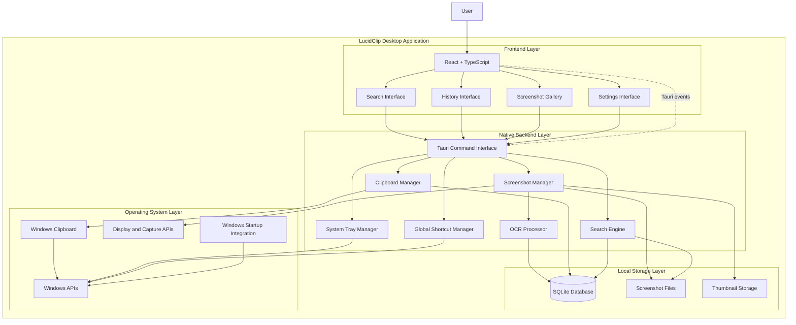

## 3.2 Floating Popup & Instant Paste Sequence

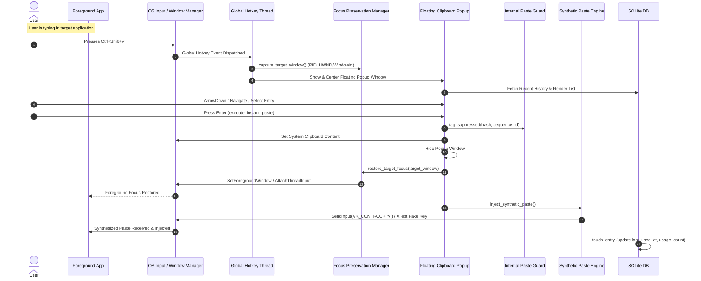

## 3.3 Architectural Layers

### Frontend Layer

Responsible for:

- Rendering the application interface.
- Displaying clipboard history.
- Displaying screenshot history.
- Handling user interactions.
- Sending requests to the Rust backend.
- Displaying search results.
- Managing temporary UI state.

### Native Backend Layer

Responsible for:

- Clipboard monitoring.
- Screenshot capture.
- OCR processing.
- Database operations.
- Search operations.
- System tray management.
- Global keyboard shortcuts.
- Application settings.
- Windows integrations.

### Storage Layer

Responsible for:

- Clipboard history persistence.
- Screenshot metadata.
- OCR text.
- User settings.
- Screenshot files.
- Thumbnail files.

### Operating System Layer

Responsible for:

- Clipboard access.
- Screen capture capabilities.
- Global shortcuts.
- System tray integration.
- Startup integration.
- Native desktop interactions.

---

# 4. Frontend Architecture

## 4.1 Technology

The frontend will use:

- React.
- TypeScript.
- Vite.
- Tailwind CSS.

The frontend will communicate with Rust through Tauri's command and event mechanisms.

## 4.2 Proposed Frontend Structure

```text
src/
│
├── components/
│   ├── layout/
│   ├── navigation/
│   ├── clipboard/
│   ├── screenshots/
│   ├── search/
│   ├── preview/
│   └── common/
│
├── pages/
│   ├── Home.tsx
│   ├── Clipboard.tsx
│   ├── Screenshots.tsx
│   ├── Pinned.tsx
│   └── Settings.tsx
│
├── hooks/
│   ├── useClipboard.ts
│   ├── useScreenshots.ts
│   └── useSearch.ts
│
├── services/
│   ├── clipboardService.ts
│   ├── screenshotService.ts
│   ├── searchService.ts
│   └── settingsService.ts
│
├── types/
│   ├── clipboard.ts
│   ├── screenshot.ts
│   └── settings.ts
│
├── utils/
│
├── App.tsx
└── main.tsx
```

This is a proposed logical structure. Actual folders should be introduced as the corresponding functionality is implemented.

## 4.3 Frontend Responsibilities

The frontend must:

1. Display stored clipboard entries.
2. Display screenshot thumbnails.
3. Provide unified search.
4. Show selected content in a preview panel.
5. Handle pinning and deletion actions.
6. Display monitoring status.
7. Provide settings controls.
8. Handle loading, empty, and error states.

The frontend must not directly access SQLite or perform unrestricted operating system operations.

These responsibilities belong to the Rust backend.

---

# 5. Rust Backend Architecture

## 5.1 Backend Responsibilities

Rust is responsible for native system operations and core application logic.

The backend should manage:

- Clipboard monitoring.
- Clipboard content processing.
- Screenshot capture.
- OCR integration.
- Database persistence.
- Search queries.
- File storage.
- System tray.
- Global shortcuts.
- Application configuration.

## 5.2 Proposed Backend Structure

```text
src-tauri/
│
├── src/
│   ├── main.rs
│   ├── lib.rs
│   │
│   ├── commands/
│   │   ├── clipboard.rs
│   │   ├── screenshots.rs
│   │   ├── search.rs
│   │   └── settings.rs
│   │
│   ├── services/
│   │   ├── clipboard_service.rs
│   │   ├── screenshot_service.rs
│   │   ├── ocr_service.rs
│   │   └── search_service.rs
│   │
│   ├── database/
│   │   ├── connection.rs
│   │   ├── migrations.rs
│   │   └── queries.rs
│   │
│   ├── storage/
│   │   ├── file_manager.rs
│   │   └── thumbnail_manager.rs
│   │
│   ├── platform/
│   │   ├── windows_clipboard.rs
│   │   ├── screen_capture.rs
│   │   ├── shortcuts.rs
│   │   └── startup.rs
│   │
│   ├── models/
│   │   ├── clipboard.rs
│   │   ├── screenshot.rs
│   │   └── settings.rs
│   │
│   └── errors.rs
│
├── capabilities/
├── migrations/
└── tauri.conf.json
```

Actual module boundaries may be adjusted as implementation requirements become clearer.

## 5.3 Backend Design Principles

- Keep operating system integrations isolated.
- Avoid unnecessary global mutable state.
- Use appropriate asynchronous execution for expensive operations.
- Use structured error handling.
- Avoid blocking the main application thread.
- Validate all frontend-originated inputs.
- Keep database transactions consistent.
- Avoid unnecessary data duplication.

---

# 6. Tauri Communication Architecture

Tauri provides communication between the React frontend and the Rust backend.

Two communication mechanisms will be used.

### Commands

Commands are used when the frontend requests an operation and expects a response.

Examples:

- Retrieve clipboard history.
- Search stored entries.
- Copy selected content.
- Delete an entry.
- Retrieve screenshot metadata.
- Update settings.

### Events

Events are used when the backend needs to notify the frontend about changes.

Examples:

- New clipboard entry captured.
- Screenshot saved.
- OCR processing completed.
- Monitoring paused.
- Monitoring resumed.
- Background operation failed.

## 6.1 Communication Diagram

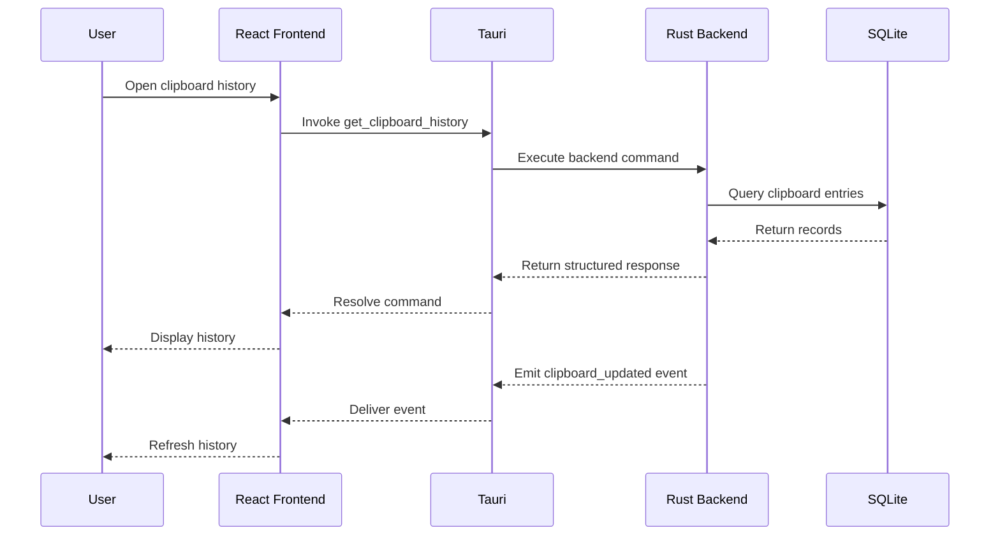

## 6.2 Communication Rules

- Commands should have clearly defined input and output types.
- Events should use structured payloads.
- Large images should not be unnecessarily serialized as base64.
- File paths should be validated before access.
- Errors should be returned in a predictable format.
- Frontend components should use dedicated service abstractions.

---

# 7. Clipboard Monitoring Architecture

Clipboard monitoring is one of LucidClip's core subsystems.

The application should detect supported clipboard changes and store eligible content.

## 7.1 Proposed Workflow

1. Application starts.
2. Clipboard monitoring service initializes.
3. Windows clipboard changes are detected.
4. Clipboard content is retrieved.
5. Privacy exclusion rules are evaluated.
6. Content is classified.
7. Duplicate detection is performed.
8. Eligible content is stored in SQLite.
9. Backend emits a history update event.
10. Frontend refreshes the relevant history view.

## 7.2 Clipboard Workflow Diagram

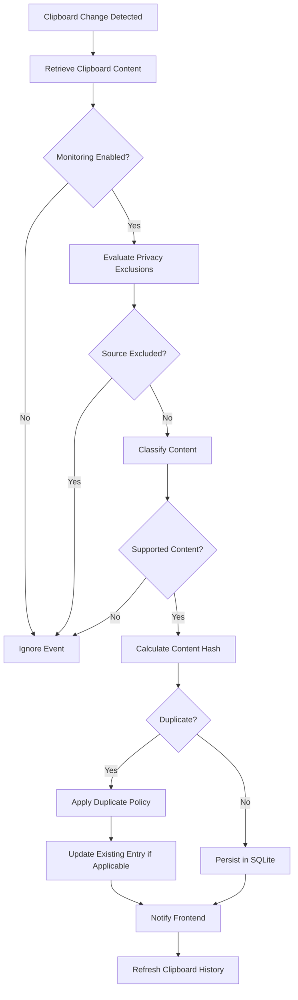

## 7.3 Clipboard Content Classification

The clipboard subsystem should identify supported formats.

Initial content categories:

- Plain text.
- URLs.
- Code-like text.
- Images where supported.
- Multiline content.

Classification should be based on content characteristics and available clipboard formats.

Do not assume every multiline string is source code.

## 7.4 Duplicate Detection

Duplicate detection should prevent unnecessary repeated entries.

A content hash can be generated for supported content.

The application should distinguish between:

- Consecutive duplicate content.
- Repeated content copied at different times.
- Existing pinned entries.

The initial implementation should favor preserving useful history over aggressively removing repeated entries.

---

# 8. Screenshot Capture Architecture

The screenshot subsystem captures selected screen content and manages local image storage.

## 8.1 Screenshot Capture Workflow

1. User activates a screenshot shortcut.
2. Screenshot capture interface opens.
3. User selects full screen or a region.
4. Windows capture functionality obtains the image.
5. Image is validated.
6. Screenshot is saved locally.
7. Thumbnail is generated.
8. Screenshot metadata is stored in SQLite.
9. OCR processing is scheduled.
10. Frontend receives a screenshot update event.

## 8.2 Screenshot Workflow Diagram

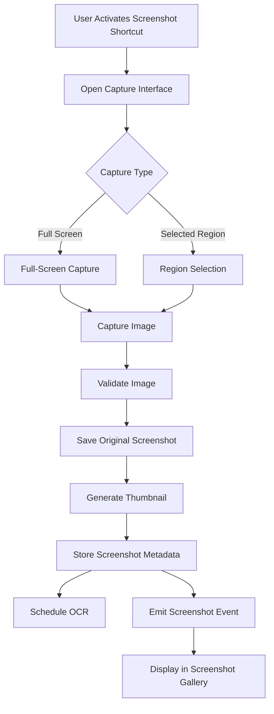

## 8.3 Local File Organization

A proposed storage structure:

```text
LucidClip/
│
├── database/
│   └── lucidclip.db
│
├── screenshots/
│   ├── originals/
│   └── thumbnails/
│
├── logs/
│
└── backups/
```

The actual storage location should use the appropriate Windows application data directory.

The application should avoid storing user data inside the installation directory.

## 8.4 Image Storage Principles

- Store original screenshots separately from thumbnails.
- Use unique filenames.
- Preserve capture timestamps.
- Validate image files.
- Avoid loading entire screenshot collections into memory.
- Handle missing files gracefully.
- Clean up associated files when screenshots are permanently deleted.
- Avoid deleting pinned content during automatic cleanup.

---

# 9. OCR Processing Architecture

OCR converts text contained in screenshots into searchable information.

LucidClip should use a local OCR engine.

No external API should be required for core OCR functionality.

## 9.1 OCR Workflow

1. Screenshot is saved.
2. OCR job is created.
3. Background worker retrieves the screenshot.
4. OCR engine processes the image.
5. Extracted text is normalized where appropriate.
6. OCR output is stored in SQLite.
7. Screenshot metadata is updated.
8. Frontend receives an OCR completion event.

## 9.2 OCR Workflow Diagram

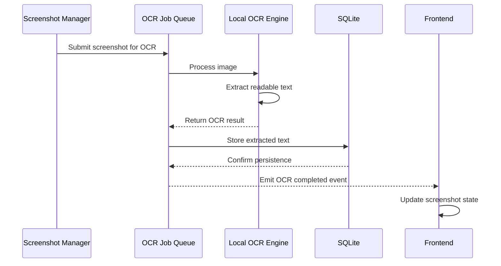

## 9.3 OCR Requirements

- OCR must execute asynchronously.
- OCR failures must not affect original screenshot storage.
- Failed OCR jobs should be recoverable.
- OCR processing should not block clipboard monitoring.
- Extracted text should be searchable.
- Support for additional OCR languages can be expanded later.

---

# 10. Database Architecture

SQLite will serve as the primary persistent database.

The database should store structured metadata and clipboard content.

Original screenshot images should remain in the filesystem.

## 10.1 Proposed Database Tables

### clipboard_entries

Stores clipboard history.

| Column | Type | Description |
|---|---|---|
| id | INTEGER | Unique identifier |
| content | TEXT | Clipboard content |
| content_type | TEXT | Content classification |
| source_app | TEXT | Source application metadata |
| created_at | TEXT | Capture timestamp |
| pinned | BOOLEAN | Pin status |
| favorite | BOOLEAN | Favorite status |
| content_hash | TEXT | Duplicate detection hash |

### screenshots

Stores screenshot metadata.

| Column | Type | Description |
|---|---|---|
| id | INTEGER | Unique identifier |
| file_path | TEXT | Original image location |
| thumbnail_path | TEXT | Thumbnail location |
| ocr_text | TEXT | Extracted text |
| created_at | TEXT | Capture timestamp |
| pinned | BOOLEAN | Pin status |
| favorite | BOOLEAN | Favorite status |

### settings

Stores application preferences.

| Column | Type | Description |
|---|---|---|
| key | TEXT | Setting identifier |
| value | TEXT | Setting value |

Additional tables may be introduced for OCR job tracking, exclusions, and future requirements.

## 10.2 Entity Relationship Diagram

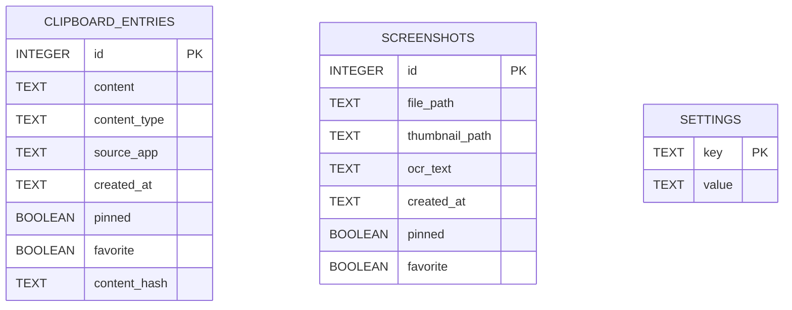

The initial schema is intentionally simple.

## 10.3 Database Design Principles

- Use parameterized SQL queries.
- Apply appropriate indexes.
- Use transactions for related operations.
- Implement schema migrations.
- Maintain database integrity.
- Avoid unnecessary database writes.
- Use appropriate timestamp formats.
- Handle concurrent access safely.
- Define backup and recovery strategies.

## 10.4 Search Strategy

Initial search can use SQLite text matching.

As the history grows, SQLite Full-Text Search (FTS5) should be evaluated for:

- Clipboard text.
- OCR-extracted text.
- Searchable metadata.

Search implementation should support pagination and avoid loading unnecessary records.

---

# 11. Unified Search Architecture

Unified search combines multiple content sources into one retrieval experience.

## 11.1 Search Sources

- Clipboard entries.
- URLs.
- Code snippets.
- Screenshot OCR text.
- Pinned entries.
- Favorites.

## 11.2 Search Workflow

1. User enters a query.
2. Frontend validates the query.
3. Search command is sent to Rust.
4. Search service queries relevant SQLite data.
5. Matching results are ranked or sorted.
6. Results are returned in a unified structure.
7. Frontend displays matching content.

## 11.3 Search Architecture Diagram

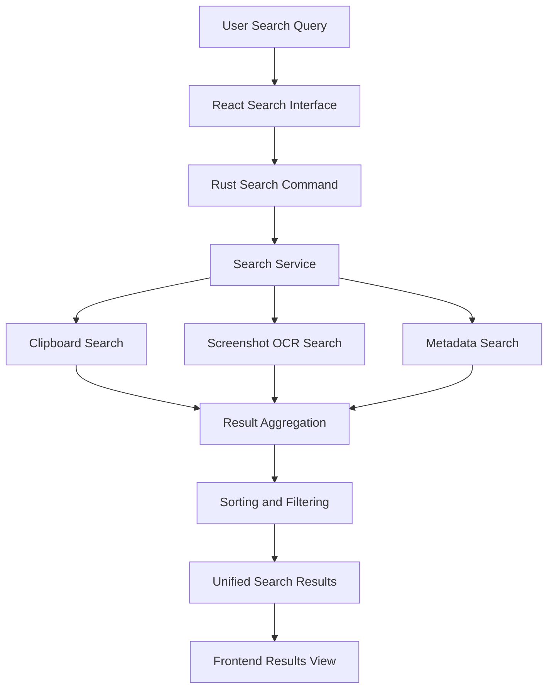

Search results should include content type, identifier, timestamp, and enough metadata for the frontend to display and retrieve the selected item.

---

# 12. System Tray and Global Shortcut Architecture

LucidClip should provide background operation without requiring the main application window to remain open.

## 12.1 System Tray Responsibilities

- Open the main application.
- Pause clipboard monitoring.
- Resume clipboard monitoring.
- Access settings.
- Exit the application.

## 12.2 Global Shortcut Responsibilities

Proposed shortcuts:

| Action | Default Shortcut |
|---|---|
| Open Quick Access | Alt + Space |
| Capture Screenshot | Ctrl + Shift + S |
| Close Quick Access | Escape |

Shortcuts must be configurable.

Shortcut registration should detect conflicts and handle registration failures gracefully.

The application must not override critical Windows shortcuts.

## 12.3 Application Lifecycle

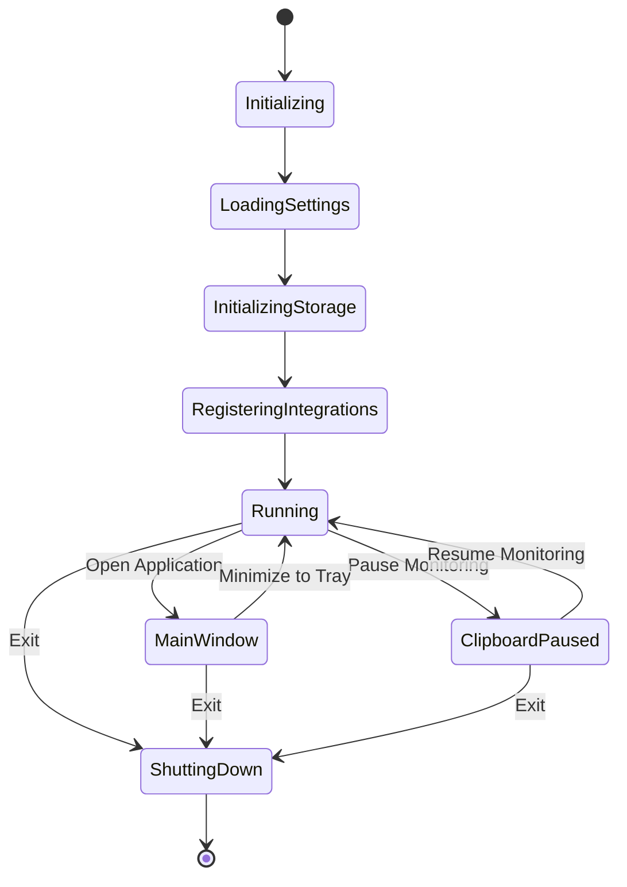

## 12.4 Lifecycle Requirements

During startup:

- Load settings.
- Initialize database.
- Initialize local storage.
- Register system tray.
- Register configured shortcuts.
- Start eligible background services.

During shutdown:

- Stop background workers gracefully.
- Complete or safely cancel pending operations.
- Release native resources.
- Close database connections.
- Preserve persistent data.

---

# 13. Application Settings Architecture

Settings should be managed centrally through the Rust backend.

The frontend should request and update settings through typed commands.

Settings may include:

- Clipboard monitoring enabled.
- Screenshot functionality enabled.
- Global keyboard shortcuts.
- Startup behavior.
- History retention.
- Application exclusion rules.
- Storage configuration.
- Theme preference.

Sensitive settings should not be exposed unnecessarily to unrelated components.

Invalid or unsupported configuration values must be rejected safely.

---

# 14. Privacy and Security Architecture

Privacy must be enforced at the backend level.

Frontend-only privacy controls are insufficient because background services may continue monitoring independently.

## 14.1 Privacy Boundaries

- All clipboard processing occurs locally.
- Screenshot files remain local.
- OCR processing occurs locally.
- No mandatory authentication.
- No cloud dependency for core functionality.
- No telemetry by default.

## 14.2 Sensitive Application Exclusions

The clipboard subsystem should evaluate source application information where reliably available.

Configured excluded applications must prevent eligible content from being persisted.

Special attention should be given to:

- Password managers.
- Authentication applications.
- Sensitive browser windows.
- Financial applications.
- User-configured private applications.

Application identification has limitations and should not be treated as perfect sensitive-content detection.

## 14.3 Security Boundaries

- Frontend commands must validate input.
- File operations must restrict access to authorized application storage locations.
- Database queries must be parameterized.
- Clipboard contents must never be executed.
- Temporary files must be managed safely.
- Unnecessary administrator permissions must be avoided.
- Tauri capabilities should follow least privilege.

---

# 15. Performance Architecture

LucidClip should remain lightweight while operating in the background.

## 15.1 Performance Requirements

- Avoid unnecessary clipboard polling.
- Prefer event-driven monitoring when supported.
- Avoid blocking the UI thread.
- Perform OCR asynchronously.
- Use thumbnail-based image previews.
- Paginate large history collections.
- Optimize database queries.
- Release unnecessary image buffers.
- Avoid repeated processing of unchanged content.

## 15.2 Background Work

The following operations should be handled outside the main UI execution path:

- Clipboard processing.
- Screenshot thumbnail generation.
- OCR.
- Large search operations.
- History cleanup.
- Database maintenance.

Background operations should support cancellation or graceful shutdown where appropriate.

---

# 16. Error Handling Architecture

All major subsystems must provide predictable error handling.

Expected error categories:

| Error | Handling Strategy |
|---|---|
| Clipboard access failure | Log error and retry when appropriate |
| Database failure | Return structured error |
| Screenshot capture failure | Inform user |
| Missing screenshot file | Mark unavailable and preserve metadata where appropriate |
| OCR failure | Preserve screenshot and report OCR status |
| Shortcut conflict | Display configuration guidance |
| Storage unavailable | Avoid data loss and notify user |
| Invalid settings | Reject and retain last valid configuration |

Errors should not silently destroy existing user data.

---

# 17. Proposed End-to-End Data Flow

LucidClip has two primary ingestion pipelines.

### Clipboard Pipeline

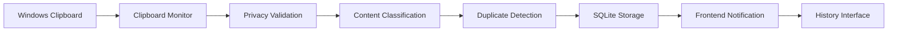

### Screenshot Pipeline

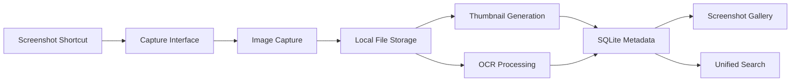

---

# 18. Proposed Deployment Architecture

LucidClip will initially target Windows x64.

The release package should contain:

- Tauri desktop application.
- Compiled Rust backend.
- Built React frontend assets.
- Required runtime dependencies.
- Local OCR resources where applicable.
- Application metadata and icons.
- Windows installer.

The user should not need to install Node.js, Python, or Rust.

## 18.1 Installation and Storage

Application binaries should be installed separately from user data.

User data should be stored in the appropriate Windows application data directory.

Application updates must preserve existing database records and screenshot files.

Uninstallation behavior should clearly distinguish between removing the application and deleting user data.

## 18.2 Release Verification

Before public distribution:

- Validate installer integrity.
- Scan release artifacts.
- Verify dependencies.
- Generate SHA-256 checksums.
- Test clean installation.
- Test application updates.
- Test uninstallation.
- Evaluate code signing.

No executable should be described as guaranteed virus-free.

---

# 19. Architecture Evolution

The architecture should evolve in five development phases.

| Phase | Architecture Focus |
|---|---|
| Phase 1 | Documentation and architectural planning |
| Phase 2 | Clipboard monitoring, backend foundation and SQLite |
| Phase 3 | Screenshot capture, storage and OCR |
| Phase 4 | Unified search, desktop interface and OS integration |
| Phase 5 | Security, optimization, compatibility and release |

New architectural components should be introduced only when justified by actual requirements.

---

# 20. Architectural Constraints and Trade-offs

### SQLite vs External Database

SQLite is preferred because LucidClip is a single-user, local-first desktop application.

A separate database server would introduce unnecessary installation and maintenance complexity.

### Rust vs Node.js Backend

Rust is preferred for native Windows integration, resource efficiency, and a single compiled backend.

### Local OCR vs Cloud OCR

Local OCR is preferred for privacy, offline functionality, and avoiding recurring API costs.

### Filesystem vs Database Image Storage

Original screenshot images should be stored in the filesystem, while SQLite stores their metadata and paths.

This avoids unnecessarily bloating the database with large image blobs.

### Tauri vs Electron

Tauri is preferred because the application needs a relatively lightweight native desktop experience.

However, actual resource consumption must be benchmarked rather than assumed.

---

# 21. Architecture Success Criteria

The architecture will be considered successfully implemented when:

- Frontend and backend responsibilities are clearly separated.
- Clipboard monitoring works reliably.
- Clipboard entries persist in SQLite.
- Screenshot storage works independently of the database.
- OCR processing runs asynchronously.
- Unified search retrieves both clipboard and screenshot content.
- System tray and global shortcuts operate correctly.
- Privacy rules are enforced in backend processing.
- Application updates preserve user data.
- The application runs without requiring development tools.

---

# 22. Conclusion

LucidClip uses a modular, local-first desktop architecture built around Tauri 2, Rust, React, TypeScript, and SQLite.

The architecture separates user interface operations from operating system integrations and persistent storage.

Its core systems—clipboard monitoring, screenshot capture, OCR, and unified search—are designed to work together without introducing unnecessary infrastructure or cloud dependencies.

The primary architectural objective is to create a reliable, lightweight, secure, and maintainable Windows application that makes previously copied and captured information instantly accessible.

**LucidClip — Everything you copy. Everything you capture. Always within reach.**