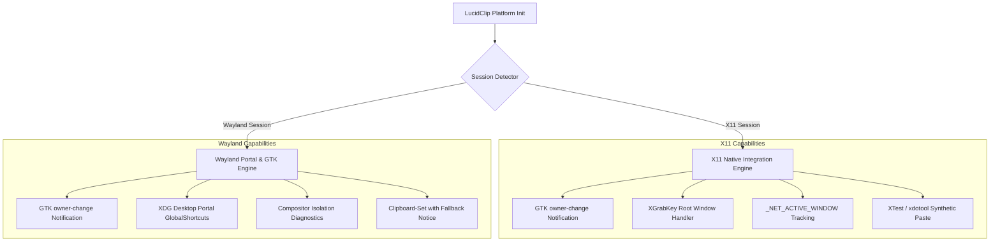

# LucidClip — Linux Platform Integration Guide

This document describes LucidClip's native Linux desktop integration architecture, covering clipboard monitoring, global keyboard shortcuts, active window tracking, focus restoration, synthetic paste injection, and runtime session diagnostics across X11 and Wayland environments.

---

## 1. Session Architecture & Security Model

Modern Linux desktop environments run under either the legacy **X11** protocol or modern **Wayland** compositors (such as GNOME Mutter, KDE KWin, or wlroots/Sway). LucidClip dynamically detects the session type at startup and adapts its native operations accordingly:



---

## 2. Clipboard Pipeline

### Native GTK Signal Handling
- LucidClip connects to the GTK 3 `GtkClipboard` owner-change signal on the primary `GDK_SELECTION_CLIPBOARD` selection.
- Operates in-process without requiring external CLI utilities (`xclip`, `xsel`, `wl-clipboard`).
- Formats captured:
  - `UTF8_STRING` / `text/plain;charset=utf-8`
  - `image/png` / `image/jpeg`
  - `text/uri-list` for file copy references from Nautilus, Dolphin, Thunar, and Nemo.

### Sensitive Content Protection
- Respects the KDE/freedesktop password-manager hint `x-kde-passwordManagerHint`.
- Entries originating from KeepassXC, Bitwarden, and 1Password carrying this tag are completely omitted from persistence.

### Loop Suppression
- Before injecting paste or copying history items to the system clipboard, LucidClip tags the content hash in the in-memory `PasteGuard` with an internal sequence tag.
- When the GTK `owner-change` event fires, the hash is matched and skipped, preventing infinite duplication loops.

---

## 3. Global Shortcuts (`Ctrl+Shift+V`)

### X11 Implementation
- Uses `XGrabKey` on the root window with modifiers `ControlMask | ShiftMask` and the keysym for `v` / `V`.
- Handles `BadAccess` errors cleanly if another running utility (e.g., terminal emulator) has already grabbed the key combination.
- Spawns a dedicated event polling thread to intercept `KeyPress` events and dispatch Tauri window events to unhide and center the floating popup.

### Wayland Implementation
- Native Wayland compositors prohibit clients from passively snooping on or grabbing global keystrokes across windows.
- LucidClip queries the Freedesktop Portal `org.freedesktop.portal.GlobalShortcuts` via D-Bus (`libdbus`).
- When the portal is unavailable or permissions are not granted by the desktop environment, LucidClip logs an actionable diagnostic message in the capability inspector.

---

## 4. Window Focus Preservation

When the user triggers the floating clipboard popup with `Ctrl+Shift+V`, LucidClip captures the currently active target window before displaying the popup window:

### X11 Window Tracking
1. Reads the `_NET_ACTIVE_WINDOW` atom on the X11 root window to determine the current `Window` ID.
2. Reads `_NET_WM_PID` to resolve the target process ID and process name.
3. Caches the window target in `ActiveWindowTarget`.
4. When the user hits `Enter` in the popup, the popup window hides, and LucidClip dispatches a `_NET_ACTIVE_WINDOW` client message to the root window to refocus the original application.

### Wayland Window Tracking
- Window management and focus transitions are strictly governed by the Wayland compositor.
- Focus restoration relies on window minimization/dismissal allowing the compositor to restore focus to the previous surface in the compositor stack.

---

## 5. Synthetic Instant Paste

When a user selects an entry and hits `Enter`:

1. **Tag & Guard**: `PasteGuard::tag_suppressed(hash, sequence_id)` registers the content.
2. **Clipboard Set**: Content is placed on `GDK_SELECTION_CLIPBOARD`.
3. **Hide Popup**: The floating popup window is immediately hidden.
4. **Focus Restoration**: Focus is handed back to the target window with a platform-calibrated settling delay (50ms).
5. **Key Synthesis**:
   - **X11**: The `XTest` extension (`XTestFakeKeyEvent`) synthesizes `Control_L` key down, `v` key down, `v` key up, `Control_L` key up. If `XTest` is disabled, LucidClip falls back to `xdotool key --window <id> ctrl+v`.
   - **Wayland**: Compositor boundaries prevent untrusted synthetic input injection. LucidClip copies the content to the clipboard and emits a toast notification (`"Copied to clipboard. Press Ctrl+V to paste."`) ensuring zero data loss.

---

## 6. Runtime Diagnostics & Troubleshooting

Inspect native clipboard integration on Linux without starting the full GUI:

```bash
cd backend
cargo run --example clipboard_probe -- --read
```

### System Dependencies
On Ubuntu / Debian distributions:
```bash
sudo apt-get install -y \
  libgtk-3-dev \
  libayatana-appindicator3-dev \
  libxdo-dev \
  libxtst-dev \
  libdbus-1-dev
```
