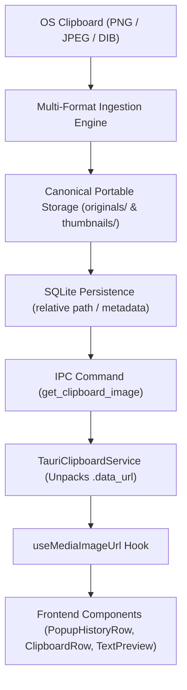

# LucidClip — Screenshot History Pipeline Fix Specification

This document provides a comprehensive root cause analysis and technical specification for resolving clipboard screenshot and image history failures in LucidClip.

---

## 1. Root Cause Analysis

### A. IPC Data Model Mismatch & `[object Object]` Rendering
- **The Backend Command:** `get_clipboard_image` and `get_screenshot_image` return a serialized `ScreenshotImageData` struct:
  ```rust
  #[derive(Debug, Clone, Serialize)]
  pub struct ScreenshotImageData {
      pub mime_type: String,
      pub data_url: String,
  }
  ```
- **The Frontend Service Breakdown:** `TauriClipboardService.ts` and `TauriScreenshotService.ts` invoked the commands using `invoke<string>('get_clipboard_image', ...)`.
- **Runtime Defect:** In JavaScript, `invoke` resolved to an object `{ mime_type: "image/png", data_url: "data:image/png;base64,..." }`.
- **The Render Failure:** Components (e.g. `ClipboardRow.tsx`, `ScreenshotThumbnail.tsx`, `TextPreview.tsx`) assigned this object directly to ``. The browser converted the object to string: `src="[object Object]"`, failing image loading and triggering `onError`, which displayed `"The stored image file is unavailable."`

### B. Popup History Row Missing Image Loading
- In `PopupHistoryRow.tsx`, the row only checked `entry.thumbnailUrl || entry.imageUrl`.
- However, `get_clipboard_entries` deliberately omits heavy base64 data URLs from list queries to keep IPC lightweight.
- Because `PopupHistoryRow.tsx` never invoked `useMediaImageUrl`, image entries in the floating popup never displayed thumbnail images.

### C. Storage Path Inflexibility Across Restarts
- `AppPaths::owns_media_path` checked `path.is_absolute() && path.starts_with(&self.screenshots_dir)`.
- If a relative path was stored in SQLite, or if LucidClip was restarted in a different directory or portable mode, `resolve_media_file` rejected the path with:
  `"Refusing to access media outside the application data directory"`.
- A resilient resolution strategy must support relative paths and basename fallbacks within `originals_dir` and `thumbnails_dir`.

### D. Clipboard Image Ingestion Limitations
- Windows clipboard capture previously only checked `CF_DIB` and `CF_DIBV5`.
- Modern browsers (Chrome, Edge, Firefox) and Electron applications (VS Code, Slack) register `"PNG"` and `"image/jpeg"` formats.
- Ingestion must detect registered image format atoms and decode memory-backed PNG/JPEG streams directly via the `image` crate.

---

## 2. Multi-Layer Resolution Strategy



## 3. Verified Production Contracts

### Rust IPC Model
```rust
#[derive(Debug, Clone, Serialize, Deserialize)]
pub struct ScreenshotImageData {
    pub mime_type: String,
    pub data_url: String,
}
```

### TypeScript Client-Side Unpacking
```typescript
export interface ScreenshotImagePayload {
  mime_type?: string;
  data_url?: string;
  mimeType?: string;
  dataUrl?: string;
}

export function extractDataUrl(raw: unknown): string {
  if (typeof raw === 'string') return raw;
  if (raw && typeof raw === 'object') {
    const payload = raw as ScreenshotImagePayload;
    return payload.data_url || payload.dataUrl || '';
  }
  return '';
}
```

### Restart-Safe Storage Resolution
- **Canonical Relative Paths:** Media references are saved as basename or relative filenames (`clip_<id>.png`).
- **Path Resolution:** `AppPaths::resolve_media_file` inspects whether the path is canonical relative, absolute within screenshots directory, or migrates by basename if the app was relocated.
- **Auto-Regeneration:** If an entry's thumbnail is missing or corrupted, `resolve_image_file` automatically reconstructs a 320x180 PNG thumbnail from the original full-resolution image on disk.

