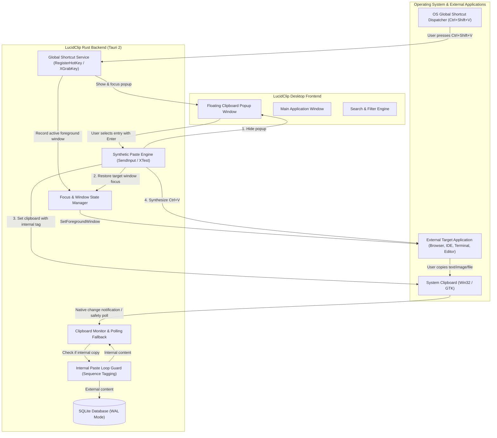

# System-Wide Clipboard Intelligence Architectural Specification

This document details the architecture, design, and implementation specification for LucidClip's system-wide clipboard monitoring, global keyboard shortcuts, dedicated floating popup window, and instant paste engine.

---

## 1. System-Wide Clipboard Architecture

---

## 2. Global Keyboard Shortcut Specification

The system-wide shortcut engine operates across foreground applications:

| Shortcut | Scope | Expected Behavior |
|---|---|---|
| **Ctrl+Shift+V** | Global (System-Wide) | Capture currently focused window, toggle the floating clipboard history popup, and focus its search bar. |
| **Arrow Up / Down** | Popup Focused | Navigate through clipboard entries. |
| **Enter** | Popup Focused | Execute Instant Paste into the previously active application. |
| **Escape** | Popup Focused | Hide/close the floating clipboard popup without pasting. |
| **Ctrl+F** | Popup Focused | Jump focus directly to search query input. |
| **Ctrl+P** | Popup Focused | Toggle pinned status on the currently selected entry. |
| **Delete** | Popup Focused | Delete the currently selected entry from database and memory. |

---

## 3. Dedicated Floating Clipboard Popup Window

- **Window Configuration**: Dedicated Tauri webview window labeled `clipboard-popup`.
- **Properties**:
  - Size: 480px width × 560px height.
  - Borderless / frameless (`decorations: false`).
  - Always on top (`alwaysOnTop: true`).
  - Taskbar behavior: `skipTaskbar: true`.
  - Position: Centered on the monitor containing the active window, or under cursor.
- **Sections**:
  1. **Header**: Brand title, search input with instant debounce, item counter, close button.
  2. **Filters**: All, Text, Images, Pinned.
  3. **History List**: Reverse chronological order, type badge, content preview, age, pin/delete actions.
  4. **Footer**: Keyboard navigation tips (`↑↓` navigate, `↵` paste, `Esc` dismiss, `Del` remove).

---

## 4. Instant Paste Engine & Focus Restoration

To paste content directly into an external application without manual copy-paste:
1. **Target Capture**: Before the popup window is made visible and focused, query `GetForegroundWindow` (Windows) or `_NET_ACTIVE_WINDOW` (Linux X11). Store the window handle and thread ID.
2. **Popup Dismissal**: When the user presses Enter or clicks an entry, instantly hide the popup window (`window.hide()`).
3. **Focus Restoration**: Restore focus to the target window using `SetForegroundWindow` and `AttachThreadInput` (Windows) or `XSetInputFocus` (Linux X11).
4. **Internal Copy Guard**: Set the target item onto the system clipboard. Increment an internal sequence counter and register the content hash in the paste guard to prevent the monitor from re-capturing this operation.
5. **Key Injection**:
   - Windows: Issue `SendInput` or `keybd_event` for `VK_CONTROL` (down) + `0x56` ('V', down), followed by release.
   - Linux X11: Issue `XTestFakeKeyEvent` for Control + V.
   - Linux Wayland / Fallback: If synthetic input is restricted by the compositor, copy to clipboard and alert user.

---

## 5. Platform Compatibility Matrix

| Capability | Windows 10/11 | Linux X11 | Linux Wayland | macOS |
|---|---|---|---|---|
| Clipboard Monitoring | Native `WM_CLIPBOARDUPDATE` | Native GTK `owner-change` | Native GTK `owner-change` | NSPasteboard polling |
| Global Shortcuts | `RegisterHotKey` Win32 API | `XGrabKey` / X11 | Compositor Portal / In-App | CGEvent / NSEvent |
| Foreground App Detection | `GetForegroundWindow` + Query | `_NET_ACTIVE_WINDOW` + `/proc` | Gated by compositor | NSWorkspace |
| Instant Paste Injection | `SendInput` / `keybd_event` | XTest extension | Clipboard-only fallback | Accessibility API |
